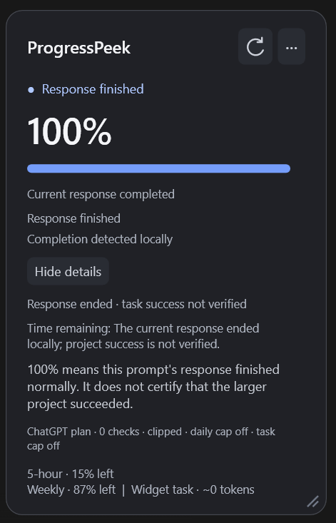
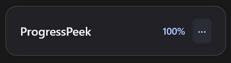
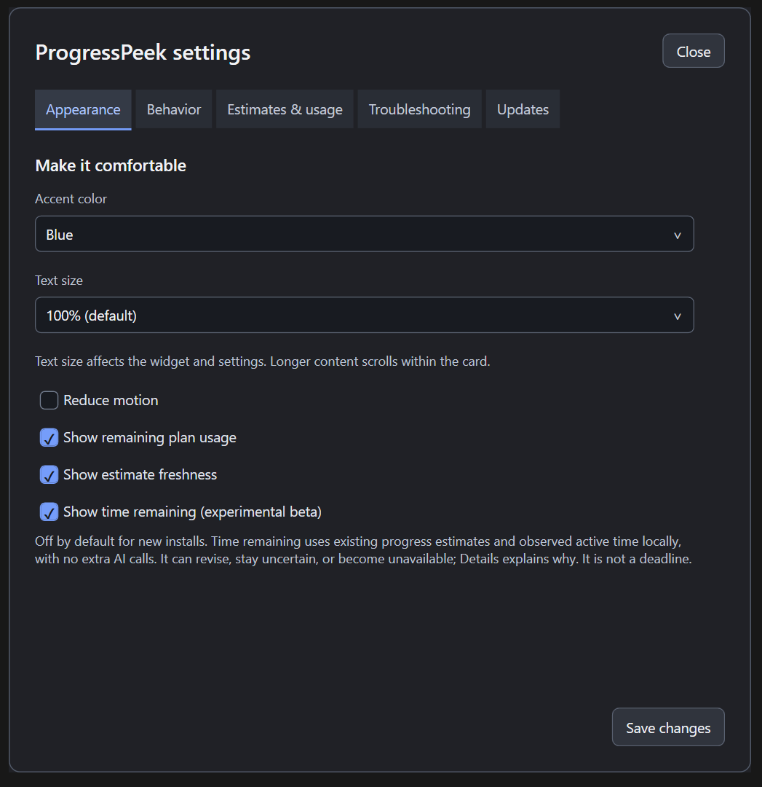

# ProgressPeek

A Windows desktop widget that estimates progress on long-running AI tasks.

This repository contains the original **0.4.0-beta** source snapshot. It contains no Dev Beta changes. It targets the desktop ChatGPT Codex / Work interface observed during development; standard browser chats and later layouts are not guaranteed to work.

**[Download 0.4.0 Beta](https://github.com/egormakarenkov/ProgressPeek/releases/tag/v0.4.0-beta)** · [Privacy](docs/PRIVACY.md) · [Known limitations](#limitations)

## Screenshots

### Expanded widget

  

<em>Completion details distinguish a finished response from verified project success.</em>

### Compact view

  

<em>A smaller view keeps the current percentage visible.</em>

### Settings

  

<em>Customize appearance and choose which information the widget displays. Saved preferences shown here may differ from new-install defaults.</em>

## Installation and setup

Choose a download from the [0.4.0-beta release](https://github.com/egormakarenkov/ProgressPeek/releases/tag/v0.4.0-beta):

| Download | Use |
|---|---|
| [Windows installer](https://github.com/egormakarenkov/ProgressPeek/releases/download/v0.4.0-beta/ProgressPeek-0.4.0-beta-setup.exe) | Recommended for a standard installation. |
| [Portable ZIP](https://github.com/egormakarenkov/ProgressPeek/releases/download/v0.4.0-beta/ProgressPeek-0.4.0-beta-portable.zip) | Extract the entire ZIP, then launch `ProgressPeek.exe`. |
| [Original source snapshot](https://github.com/egormakarenkov/ProgressPeek/releases/download/v0.4.0-beta/ProgressPeek-0.4.0-beta-source.zip) | The preserved source archive used for build verification. |
| [SHA-256 checksums](https://github.com/egormakarenkov/ProgressPeek/releases/download/v0.4.0-beta/SHA256SUMS.txt) | Check the installer and archive hashes. |

Close an existing instance before installing. Downloads require repository access while the repository is private. No Microsoft Store listing is linked.

Windows with .NET Framework 4.x / WPF is required; development verification used Windows 11. Read Setup & privacy on first launch. AI estimates require explicit consent and a compatible, installed Codex CLI signed into a supported plan. Follow the [official installation instructions](https://github.com/openai/codex) and [authentication guide](https://developers.openai.com/codex/auth). Models and plan availability can vary. No credentials or API keys are bundled, and there is no paid API fallback.

Observe a supported task, use Refresh when needed, and open the widget menu for Settings or Exit. AI checks consume plan allowance. **100% means the response finished normally, not that the wider project succeeded.** Estimates can revise; ETA is experimental and defaults off.

## Limitations

This frozen beta depends on accessibility information from the observed desktop interface. Keep the latest response accessible; unsupported layouts may yield unavailable or stale estimates. Clean-PC and real multi-monitor verification remain items in the archived testing checklist. The built-in updater is unconfigured in this release; creating a GitHub repository will not enable it. No universal accuracy or Microsoft Store certification is claimed.

## Source and documentation

The complete archived snapshot is unchanged under [src](src/), including its original documentation, build scripts and packaging allowlist. Its comparison rebuild matched the approved application's contents except for compiler-generated timestamps and module identifiers. Original release binaries are distributed separately rather than replaced by that comparison build.

- [Original build instructions](src/README.md)
- [Privacy](docs/PRIVACY.md)
- [Security](docs/SECURITY.md)
- [Testing checklist](docs/CLEAN-PC.md)
- [Changelog](docs/CHANGELOG.md)
- [Contribution policy](docs/CONTRIBUTING.md)

To build with Windows PowerShell 5.1, run `powershell.exe -NoProfile -File .\src\build.ps1 -OutputDirectory C:\ProgressPeek-build`. Choose a separate output directory. See the original documentation for compiler requirements and tests. Never overwrite preserved release assets with a rebuild.

For bug reports, include the version, Windows version, interface used, reproduction steps and a redacted screenshot. Do not include credentials or private chat content. A private security contact has not yet been designated.

## License and publication status

Software usage/source licensing terms and the public contribution policy remain publisher decisions. No MIT or other open-source license is implied. Version 0.4.0-beta is a prerelease; repository visibility controls access to its files and downloads.
